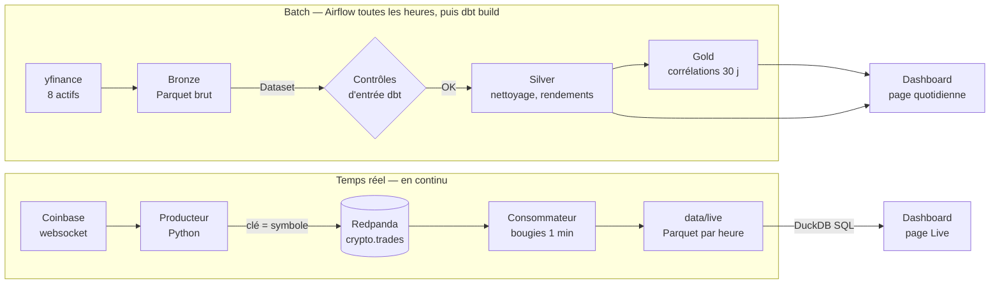
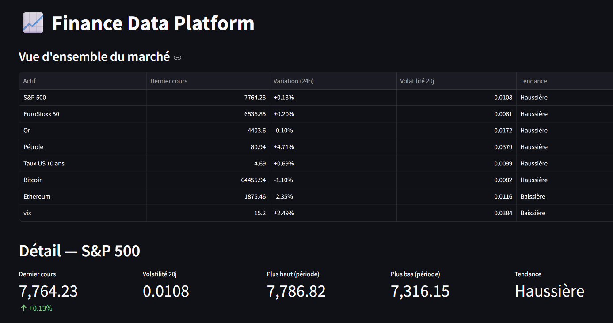
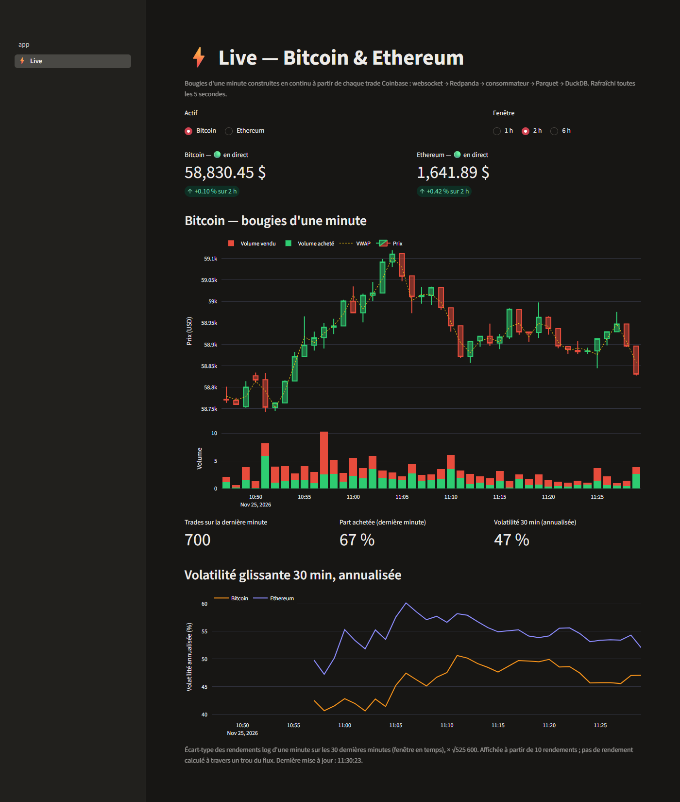

# 📈 Finance Data Platform — Pipeline Data Engineering Multi-Actifs, batch et temps réel

Un projet de data engineering axé sur l'ingestion, la transformation et l'agrégation de données financières en continu, via une architecture en couches et une orchestration autonome.

Finance Data Platform est un pipeline ETL construit autour de huit actifs représentatifs (actions, matières premières, taux, cryptomonnaies, indicateur de volatilité), conçu pour tourner de façon totalement autonome sur un poste de travail personnel — sans dépendre d'un serveur toujours allumé. Le système extrait quotidiennement les cours de marché, les nettoie et les enrichit avec **dbt**, puis calcule des indicateurs de risque et de corrélation inter-actifs, restitués dans un dashboard interactif de niveau trading. Des tests de qualité bloquent toute donnée invalide avant qu'elle n'atteigne le dashboard, et une CI vérifie le tout à chaque push.

À côté de ce batch quotidien, une **couche temps réel** suit chaque trade Bitcoin et Ethereum de Coinbase, le fait transiter par un broker compatible Kafka et le transforme en bougies d'une minute, avec une garantie de livraison testée en provoquant de vrais crashs. Les deux chemins coexistent : c'est une **architecture lambda**.

---

## 🏗️ Architecture en Couches (Medallion Pattern)

Le pipeline suit une architecture médaillon Bronze / Silver / Gold, standard en data engineering pour séparer strictement donnée brute et donnée transformée :

| Couche | Rôle | Opérations |
|---|---|---|
| **Bronze** | Ingestion brute | Extraction yfinance (Python), valeurs non modifiées, colonnes au format d'un contrat de schéma, Parquet partitionné par date de run |
| **Silver** | Nettoyage & enrichissement (dbt) | Version la plus récente de chaque jour, prix invalides écartés, rendements log, moyennes mobiles (20/50 séances), volatilité glissante (20 séances) |
| **Gold** | Agrégation analytique (dbt) | Calendrier complet multi-marchés, corrélations glissantes 30 jours entre chaque paire d'actifs |

* **Bronze** conserve les valeurs telles que renvoyées par l'API, en accumulant à chaque run une fenêtre glissante de plusieurs jours, ce qui garantit qu'on peut toujours revenir à la source. Seule la **forme** est imposée : yfinance renvoie des colonnes à deux niveaux (`('Close', 'BTC-USD')`) dont le nom change d'un actif à l'autre, ce qui empêchait de réunir les actifs dans une même table SQL. Un contrat (`src/bronze_schema.py`) fixe les noms, l'ordre, les types et l'unité de temps.
* **Silver** reconstitue l'**historique complet** à partir de tous les runs Bronze, en gardant pour chaque jour la version du run le plus récent : la bougie crypto du jour est encore incomplète lors des premiers runs. Les fenêtres comptent des **séances** (`ROWS`), la convention des marchés.
* **Gold** gère un problème structurel du sujet : les marchés traditionnels ferment le week-end, la crypto cote en continu. Les séries sont alignées sur un calendrier complet en reprenant le dernier **prix** connu, puis les rendements sont calculés : un samedi donne un rendement nul, le lundi porte tout le mouvement depuis vendredi. Au-delà de 4 jours sans cotation, il s'agit d'un trou de données et rien n'est complété (voir la section dbt).

---

## 🧱 Transformations avec dbt

Silver et Gold sont des modèles **dbt** (SQL), exécutés par le DAG `dbt_build` dès qu'une extraction Bronze réussit. Une seule commande, `dbt build`, enchaîne le chargement du référentiel des actifs, les contrôles d'entrée, l'écriture de Silver puis de Gold, et les contrôles de sortie.

| Modèle | Rôle | Matérialisation |
|---|---|---|
| `stg_bronze_prices` | Lecture directe des Parquet Bronze, une ligne par actif et par jour (version du run le plus récent) | Vue |
| `silver_daily_prices` | Rendements, moyennes mobiles, volatilité | Parquet, `data/silver/daily_prices.parquet` |
| `gold_correlations_30d` | Corrélations glissantes par paire | Parquet, `data/gold/correlations_30d.parquet` |
| `tickers` (seed) | Référentiel des actifs : classe, ordre des paires. Un test pytest le garde aligné sur `config/tickers.py` | Table |

### Des tests qui bloquent avant d'écrire

Avec dbt, les tests d'un modèle s'exécutent *après* son écriture. Les contrôles qui doivent bloquer sont donc posés **en amont**, sur le staging : si l'un d'eux échoue, dbt saute Silver et Gold, la tâche Airflow passe en échec, et le dashboard garde les dernières données valides (principe *write-audit-publish*).

| Où | Contrôles |
|---|---|
| **Entrée** (staging) | unicité (actif, jour), prix strictement positifs, `high ≥ low`, ouverture et clôture dans [low, high], volume ≥ 0 (nul pour un indice ou un taux), actif connu du référentiel |
| **Fraîcheur** (staging) | la crypto, qui cote tous les jours, a une cotation d'hier au plus tard ; chaque actif a une cotation de moins de 7 jours |
| **Sortie** (Silver, Gold) | unicité, volatilité positive, rendements finis, corrélation dans [-1, 1], les 28 paires présentes au dernier jour, paires orientées selon le référentiel |

Vérifié en injectant une clôture négative dans une copie de Bronze : deux contrôles d'entrée échouent, Silver et Gold sont sautés, et aucun fichier n'est écrit.

**5 tests unitaires dbt** vérifient en plus la *logique* des modèles sur des données simulées : la dernière version d'un jour l'emporte, les prix invalides sont écartés, la première séance n'a pas de rendement, un week-end donne un rendement mais pas un trou d'un mois, la corrélation exige une fenêtre complète. Ils tournent dans la CI.

### Une migration prouvée équivalente

Silver et Gold étaient calculés en pandas. La migration vers dbt a d'abord reproduit **exactement** les anciens résultats, vérifiés ligne à ligne contre la sortie pandas (597 lignes Silver sur 9 colonnes et 2 527 lignes Gold, écart relatif inférieur à 10⁻⁹, `NULL` aux mêmes endroits). Les corrections de méthode ne sont venues qu'ensuite, chacune dans son propre commit avec ses chiffres avant/après. Mélanger « je migre » et « je corrige » aurait rendu les deux invérifiables.

### Deux biais corrigés après la migration

1. **Le mouvement du vendredi comptait trois fois.** L'ancien code complétait les week-ends en recopiant le dernier *rendement*. Pour les actions, le mouvement du vendredi était donc compté le vendredi, le samedi et le dimanche, ce qui écrasait leurs corrélations avec la crypto. Gold reprend désormais le dernier *prix* : au 25/11, la corrélation S&P 500/Bitcoin passe de 0,26 à 0,53 et Or/Bitcoin de 0,09 à 0,42, tandis que Bitcoin/Ethereum, deux actifs qui cotent tous les jours, ne bouge pas (écart nul sur toutes les paires crypto/crypto).
2. **Un mois de mouvement présenté comme une séance.** Après la panne d'un mois de la V1, Silver calculait le rendement de la première séance par rapport à la dernière cotation, un mois plus tôt : +20,6 % « en une séance » pour Bitcoin. Au-delà de 4 jours depuis la séance précédente (la plus longue fermeture normale d'un marché), le rendement vaut désormais `NULL`, et Gold ne complète plus les prix. Le pic de volatilité 20 séances de Bitcoin passe de 5,1 % à 2,8 %, et 1 239 corrélations calculées sur des données inventées pendant la panne disparaissent.

Le seuil de 4 jours est une variable du projet dbt (`max_market_closure_days`), partagée par Silver et Gold.

**Limite restante** : les rendements nuls du week-end diluent légèrement les corrélations entre actions et crypto, puisque la crypto bouge le week-end. La méthode la plus rigoureuse consisterait à calculer chaque paire sur leurs seuls jours de cotation communs (rendements synchrones).

---

## ⚡ Couche temps réel (streaming)

Chaque trade BTC-USD et ETH-USD publié par Coinbase (environ 15 par seconde) suit le chemin suivant :

| Étape | Composant | Rôle |
|---|---|---|
| Ingestion | `src/stream/producer.py` | Websocket Coinbase, normalisation des messages, envoi dans le topic avec le **symbole comme clé** : tous les trades d'un actif vont dans la même partition et restent donc dans l'ordre. |
| Transport | Redpanda (`crypto.trades`) | Broker compatible avec le protocole Kafka, en un seul binaire sans ZooKeeper ni JVM. 2 partitions, rétention 7 jours. |
| Agrégation | `src/stream/bars.py` | Bougies d'une minute en **temps d'événement** : OHLC, volume, VWAP, part achetée. Une bougie se ferme quand le **watermark** (trade le plus récent − 10 s) dépasse sa fin. |
| Écriture | `src/stream/writer.py`, `storage.py` | Upsert idempotent dans un fichier Parquet par symbole et par heure, puis seulement validation des offsets. |
| Lecture | `src/stream/live_queries.py` | Rendements et volatilité glissante calculés en SQL par DuckDB, directement sur les fichiers, pendant que le consommateur écrit. |

### Garantie de livraison : au moins une fois, sans doublon

Le consommateur suit une règle unique : **écrire d'abord, valider l'offset ensuite**. L'offset validé n'est pas celui du dernier message lu, mais celui du plus ancien trade encore présent dans une bougie ouverte. Si le processus meurt, il reprend à ce point, rejoue des trades déjà vus, reconstruit les mêmes bougies et les réécrit par upsert. Combinée à une écriture idempotente, la garantie « au moins une fois » produit donc le même résultat qu'un « exactement une fois », sans la complexité des transactions Kafka.

Côté producteur, la reconnexion au websocket est automatique (délai exponentiel, reconnexion forcée après 30 s sans message) et le producteur Kafka est idempotent. Les `trade_id` Coinbase se suivant sans trou par actif, les trades perdus pendant une coupure réseau sont **détectés et comptés** dans les logs.

### Ce qui a été vérifié, et comment

* **Crashs simulés** : un faux journal Kafka est consommé avec trois interruptions brutales à des moments aléatoires, puis comparé au même traitement sans interruption. Résultat identique sur 200 graines aléatoires.
* **Crash réel** : `docker kill` du consommateur en pleine minute, 60 s d'arriéré, relance. Les 56 bougies sur disque correspondent à 100 % à un recomptage indépendant fait directement depuis le topic, y compris la bougie coupée en deux par le crash.
* **Coupure réseau réelle** : `docker network disconnect` du producteur pendant 40 s. Le flux figé est détecté, la reconnexion se fait seule, et les 509 trades manqués sont comptés. Le cas s'est aussi produit sans être provoqué : Coinbase a fermé la connexion de lui-même, le producteur s'est reconnecté en 2 s et a signalé les 28 trades perdus entre-temps (0,2 % du flux sur la période).
* **Calculs** : les bougies et la volatilité sont comparées à des calculs pandas écrits séparément (écart nul, ou de l'ordre de 10⁻¹⁶).

Ces tests ont révélé trois bugs corrigés avant mise en service, qui sont autant de pièges classiques du streaming :

1. **Fermeture d'après l'horloge pendant un rattrapage.** Les bougies d'un actif sans nouveau trade se ferment d'après l'horloge. Après un redémarrage, le consommateur rejoue des trades de 10:02 alors qu'il est 10:30 : chaque bougie se fermait dès son premier trade rejoué et écrasait la bonne version. L'horloge n'est désormais utilisée que lorsque le consommateur est à jour (même principe que les *idle sources* de Flink).
2. **Trade en retard rejoué.** Un trade arrivé après la fermeture de sa bougie est ignoré, mais au rejeu un agrégateur neuf ne savait pas que cette bougie était déjà écrite et la recréait avec un seul trade. Au démarrage, les minutes déjà présentes sur disque sont maintenant marquées fermées.
3. **Hachage de clé différent selon le client.** Par défaut, `confluent-kafka` répartit les clés en CRC32, alors que les clients Java et `rpk` utilisent murmur2 : la même clé pouvait atterrir dans deux partitions différentes, ce qui casse l'ordre par actif. Le producteur utilise maintenant `murmur2_random`.

### Limites assumées

* **Le flux a des trous quand le PC est éteint.** Les minutes manquantes restent vides : aucun rendement n'est calculé à travers un trou, et la volatilité utilise une fenêtre en temps (`RANGE`), pas en lignes. Le dashboard affiche l'ancienneté de la dernière bougie.
* **Les trades perdus pendant une coupure sont détectés, pas récupérés** : le websocket ne rejoue pas l'historique. Une amélioration possible consisterait à combler les trous via l'API REST de Coinbase.
* **Un seul broker, sans réplication** : suffisant sur un poste de développement, pas en production.
* **Un trade arrivé plus de 10 s après la fin de sa minute est ignoré**, et compté dans les logs, pour ne jamais réécrire une bougie déjà publiée. En pratique, ce compteur reste à zéro sur ce flux.

---

## 💹 Actifs Suivis

Un actif par grande classe, pour observer des dynamiques et des corrélations réellement différentes plutôt que des variantes d'un même marché :

* **Actions** : S&P 500 (`^GSPC`), EuroStoxx 50 (`^STOXX50E`)
* **Matières premières** : Or (`GC=F`), Pétrole (`CL=F`)
* **Taux** : US 10 ans (`^TNX`)
* **Cryptomonnaies** : Bitcoin (`BTC-USD`), Ethereum (`ETH-USD`)
* **Sentiment de marché** : VIX (`^VIX`), indice de volatilité implicite du S&P 500, utilisé comme baromètre de la peur

---

## ⚙️ Orchestration & Automatisation

Le pipeline est orchestré par **Apache Airflow** (LocalExecutor, base Postgres), et les couches s'enchaînent par **Datasets** : `bronze_extract` publie le Dataset Bronze, ce qui lance `dbt_build`, qui construit et contrôle Silver et Gold. Chaque DAG déclare ce qu'il consomme et ce qu'il produit, sans connaître le suivant. dbt est installé dans un environnement virtuel séparé à l'intérieur de l'image (Airflow et dbt épinglent des versions différentes des mêmes bibliothèques) et appelé en ligne de commande.

**Un poste qui n'est pas un serveur** : le PC n'est pas allumé en permanence. Le DAG Bronze est planifié toutes les heures avec `catchup=False` : quand le PC sort de veille et que le scheduler repart, Airflow lance tout de suite le dernier créneau manqué, un seul. L'extraction calcule ensuite combien de jours relire depuis le dernier run réussi (`compute_lookback_days`), pour combler le trou laissé par la coupure au lieu de le garder pour toujours. Le dossier Bronze du jour est volontairement ignoré dans ce calcul : chaque run du jour le réécrit, et le prendre en compte faisait écraser le rattrapage du premier run par la petite fenêtre du deuxième (bug constaté et couvert par un test).

**Pourquoi la V1 a été abandonnée** : la V1 déclenchait l'extraction par une tâche planifiée Windows, au déverrouillage de session. En pratique, sur 359 déclenchements, **320 ont échoué** parce que le moteur Docker n'était pas joignable au moment du déverrouillage, et l'erreur n'apparaissait que dans un fichier de log local. En plus, une fenêtre PowerShell s'ouvrait à chaque fois. La V2 confie la planification à l'outil fait pour ça et rend les échecs visibles : une extraction partiellement en échec, ou un contrôle dbt qui ne passe pas, fait échouer la tâche Airflow (avec retries) au lieu d'afficher un run vert.

**Robustesse face aux runs rapprochés** :
* `max_active_runs=1` sur chaque DAG, pour empêcher deux exécutions concurrentes.
* **Écriture via fichier temporaire local au conteneur** avant copie finale vers le volume partagé, plutôt qu'une écriture ou un renommage direct sur le volume monté depuis Windows — après avoir constaté que ni l'atomicité du rename ni `shutil.move` ne fonctionnent de façon fiable sur ce type de montage cross-filesystem.

**Cohérence des dépendances entre environnements** : une divergence de version de `pyarrow` entre le conteneur (Linux, installé via `requirements.txt`) et la machine locale (Windows) a provoqué une corruption silencieuse des fichiers Parquet — les métadonnées écrites par une version n'étaient pas relisibles par l'autre, entraînant des erreurs `Repetition level histogram size mismatch` à la lecture. Diagnostiqué en comparant explicitement les versions installées de part et d'autre, puis résolu en épinglant une version exacte (`pyarrow==19.0.0`) dans `requirements.txt`, garantissant que conteneur et environnement local utilisent strictement la même version.

Le pipeline est **idempotent** : des déclenchements multiples dans la même journée ne dupliquent jamais de données, puisque Silver garde une seule version de chaque jour, la **plus récente** (un contrôle d'unicité le vérifie à chaque run).

---

## 📊 Dashboard

Un dashboard **Streamlit** conçu pour être lisible par n'importe qui, pas seulement un public technique :

* **Vue d'ensemble du marché** : tableau comparatif de tous les actifs (dernier cours, variation 24h, volatilité, tendance)
* **Vue thermique (treemap)** : façon Finviz, chaque actif coloré selon sa variation du jour
* **KPI par actif** : dernier cours, variation, volatilité 20j, plus haut/plus bas sur la période, tendance
* **Chandelier japonais** : ouverture/clôture/plus haut/plus bas, standard de lecture en finance
* **Performance comparée (base 100)** : tous les actifs normalisés pour comparer leur performance relative sur la période
* **Baromètre de la peur (VIX)** : jauge visuelle avec zones (calme/normal/tension/panique)
* **Corrélation live** : heatmap calculée sur la période sélectionnée, en complément de la version Gold (rolling 30j) qui prend le relais une fois l'historique suffisant
* **Actualités récentes** : dernières news liées à l'actif sélectionné, via l'API `yfinance`
* **Section debug/transparence** : données Bronze brutes exposées, pour vérifier visuellement l'intégrité du pipeline d'ingestion

*Point d'attention assumé* : la section actualités effectue un appel réseau direct au moment de l'affichage, hors du pipeline Bronze/Silver/Gold — un compromis pragmatique pour de la fraîcheur d'info, qui casse volontairement la logique "tout est versionné et reproductible" appliquée au reste du projet.

Une **page Live** affiche la couche temps réel et se rafraîchit toutes les 5 secondes (seul le bloc live est réexécuté, grâce à `st.fragment`) :

* dernier prix et variation de BTC et ETH, avec un **badge de fraîcheur** du flux (en direct, en retard, arrêté) ;
* bougies d'une minute avec VWAP, et volume découpé en achats et ventes pour lire la pression acheteuse ;
* volatilité glissante sur 30 minutes des deux actifs, annualisée.

L'URL `?refresh=off` fige la page, par exemple pour une capture d'écran.

---

## 🧪 Tests

Trois niveaux de tests :

**64 tests pytest** sur le code Python :
* contrat de schéma Bronze, fenêtre de rattrapage après une coupure, échec visible quand un ticker manque ;
* **test de régression sur l'écriture des fichiers Parquet**, ajouté après un bug de corruption rencontré en conditions réelles (voir section Orchestration) ;
* intégrité des DAGs : chargement sans erreur, planification, déclenchement de dbt par Bronze, et `dbt build` plutôt que `dbt run` (dans l'image, là où Airflow est installé) ;
* streaming : normalisation des messages Coinbase, détection des trades manqués, bougies (watermark, retard, doublons, offset sûr), écriture idempotente, **reprise après crash** sur un faux journal Kafka, métriques DuckDB (trous, fenêtre en temps). Cette logique est isolée du réseau (`events.py`, `bars.py`, `writer.py`) : elle se teste sans websocket ni broker.

**22 contrôles de données dbt** à chaque run du pipeline, et **5 tests unitaires dbt** sur la logique des modèles (voir la section dbt).

**Une CI GitHub Actions** à chaque push et pull request, en deux jobs : les tests Python sans Airflow, puis la construction de l'image Docker de production, dans laquelle tournent tous les tests pytest, `dbt build` et les tests unitaires dbt. Comme la CI n'a accès ni aux vraies données ni à yfinance, `scripts/make_bronze_fixture.py` génère un Bronze synthétique réaliste : 8 actifs sur 120 jours, pas de cotation le week-end hors crypto, volume nul pour les indices, runs qui se chevauchent.

    pytest tests/ -v                                                      # en local (les tests des DAGs sont ignorés sans Airflow)
    docker compose exec airflow-scheduler python -m pytest tests -v       # tous les tests, DAGs compris
    docker compose exec -w /opt/airflow/dbt airflow-scheduler dbt build --exclude-resource-type unit_test
    docker compose exec -w /opt/airflow/dbt airflow-scheduler dbt test --select test_type:unit

---

## 🔧 Choix Techniques

* **Airflow** pour l'orchestration : retries natifs, logs centralisés, dépendances explicites entre couches — préférable à un simple script séquentiel dès que le pipeline gagne en complexité.
* **Parquet** plutôt que CSV : format colonnaire compressé, qui conserve les types de données.
* **Pas de Spark** : le volume (8 tickers, historique quotidien) tient largement en mémoire sur une seule machine — Spark ajouterait de la complexité sans bénéfice réel.
* **dbt-duckdb pour Silver et Gold** : des transformations en SQL lisible, documentées et testées au même endroit. DuckDB lit Bronze directement en Parquet et écrit Silver et Gold en Parquet (matérialisation `external`) : le dashboard lit des fichiers, sans base partagée. La base de travail de dbt est un fichier local au conteneur, que seul dbt ouvre, et jamais deux fois en même temps.
* **Tests génériques maison** (`unique_combination`, `expression_is_true`) plutôt que le paquet `dbt_utils` : aucune dépendance à télécharger au build ou en CI.
* **DuckDB pour les métriques live** : il lit les fichiers Parquet du consommateur à la demande, sans base à maintenir. Les fichiers ne sont pas écrits dans un `.duckdb` : DuckDB n'accepte qu'un seul processus en écriture, ce qui aurait empêché le dashboard de lire pendant que le consommateur écrit.
* **Redpanda plutôt qu'Apache Kafka** : même protocole, donc mêmes clients et mêmes concepts (partitions, offsets, groupes de consommateurs), mais un seul binaire léger, sans ZooKeeper ni JVM, adapté à un poste personnel.
* **Consommateur en Python plutôt que Spark Structured Streaming** : le fenêtrage, le watermark et la gestion des offsets sont écrits et testés explicitement, ce qui les rend lisibles. Le consommateur étant un composant séparé, il peut être remplacé par un job Spark sans toucher au reste.
* **Un fichier Parquet par symbole et par heure** pour les bougies live : un fichier par bougie produirait 2 880 petits fichiers par jour et ralentirait la lecture, un fichier par lot casserait l'idempotence au rejeu.
* **Docker Compose** pour la reproductibilité : l'ensemble du pipeline (Airflow et Postgres) se lance en une seule commande, avec `restart: unless-stopped` pour repartir tout seul quand Docker Desktop démarre.
* **Image Docker dédiée** : les dépendances sont installées une fois au build, et non plus à chaque démarrage du conteneur (lent, et impossible sans réseau).

---

## 🗂️ Stack Technique

| Composant | Outil |
|---|---|
| Extraction | Python, yfinance |
| Orchestration | Apache Airflow (LocalExecutor, Datasets), PostgreSQL |
| Transformations | dbt-core 1.12, dbt-duckdb |
| Streaming | Websocket Coinbase, Redpanda (API Kafka), confluent-kafka |
| Stockage | Parquet |
| Traitement | DuckDB (SQL), Pandas, NumPy |
| Dashboard | Streamlit, Plotly |
| Qualité | pytest, tests de données et tests unitaires dbt |
| CI | GitHub Actions |
| Conteneurisation | Docker / Docker Compose |

---

## 📁 Structure du Projet

    finance-data-platform/
    ├── .github/workflows/       # CI GitHub Actions
    ├── config/                  # configuration (tickers suivis)
    ├── dags/                    # DAGs Airflow (bronze_extract, dbt_build) et Datasets partagés
    ├── dbt/                     # projet dbt
    │   ├── models/              # staging, silver, gold, tests unitaires
    │   ├── seeds/               # référentiel des actifs
    │   └── tests/               # tests singuliers et génériques
    ├── src/                     # extraction Bronze et contrat de schéma
    │   └── stream/              # couche temps réel : producteur, bougies, consommateur, requêtes DuckDB
    ├── dashboard/               # Streamlit : app.py (navigation), quotidien.py, live.py
    ├── scripts/                 # Bronze synthétique pour la CI, utilitaires de debug
    ├── tests/                   # tests pytest
    ├── data/                    # données générées (non versionnées) : bronze/, silver/, gold/, live/
    ├── Dockerfile               # image Airflow avec les dépendances du pipeline et dbt
    ├── Dockerfile.stream        # image légère des services streaming
    ├── docker-compose.yml       # Postgres, Airflow, Redpanda, producteur, consommateur
    ├── requirements-airflow.txt # dépendances de l'image Airflow
    ├── requirements-dbt.txt     # dbt, dans un environnement séparé de l'image
    ├── requirements-stream.txt  # dépendances de l'image streaming
    ├── requirements.txt         # dépendances du dashboard et des tests en local
    └── pytest.ini

---

## 📸 Aperçu visuel

---

## 🚀 Lancement Rapide

1. Cloner le dépôt :

       git clone https://github.com/paulfvt/finance-data-platform.git
       cd finance-data-platform

2. Démarrer toute la plateforme avec Docker (le premier lancement construit les images) :

       cp .env.example .env    # puis changer le mot de passe admin
       docker compose up -d --build

   Cette commande lance le batch (Postgres, Airflow avec dbt) et la couche temps réel (Redpanda, producteur, consommateur). Interface Airflow sur http://localhost:8080. Ensuite, plus rien à lancer à la main : si Docker Desktop démarre avec Windows, tout repart seul.

3. Lancer le dashboard Streamlit :

       pip install -r requirements.txt
       streamlit run dashboard/app.py

   Page quotidienne sur http://localhost:8501, page Live sur http://localhost:8501/Live.

4. Observer le flux (facultatif) :

       docker compose logs -f stream-producer stream-consumer        # débit, trades manqués, bougies écrites
       docker compose exec redpanda rpk topic consume crypto.trades -n 5
       docker compose exec redpanda rpk group describe bars-writer   # offsets validés et retard du consommateur

5. Lancer les tests :

       pytest tests/ -v

---
*Projet en développement continu — l'historique s'accumule quotidiennement ; la couche Gold devient pleinement significative à partir de 30 jours de données, la volatilité live à partir de 10 minutes de flux continu.*
